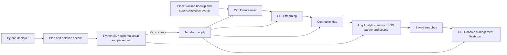

# OCI Block Volume Backup Activity

This repository generates an OCI Console **Management Dashboard JSON** and deploys its native event ingestion with Terraform. The collector has been removed. There are no Functions, VM, scheduler, inventory scanner, checkpoint bucket, dynamic groups or custom backup metrics.



The deployment region and tenancy OCID come from your existing OCI API-key profile. Terraform discovers its home region and namespace. No environment.sh is required. **Nothing has been deployed.** No backups or backup policies are created, changed or deleted.

## What the dashboard shows

Fifteen widgets use native `tile` and `summary_table` export shapes from the supplied WAF reference archive:

All nine numeric tiles explicitly label their final count as **Events**, using OCI’s supported custom-caption setting. See [caption verification](docs/tile-caption-fix.md).

- Recorded backup-creation and copy successes/failures over 24 hours and seven days.
- Unknown/conflicting completion statuses over seven days.
- Thirty-day failure history, preserved after later successful events.
- Recent operation details: event time/ID, backup name/OCID, volume OCID where supplied, compartment, source region, operation, source type and optional errors.
- Separate daily backup/copy outcome tables over thirty days (deduplicated event counts by UTC day and outcome).
- Invalid/missing event identity/time and unknown/conflicting status diagnostics.
- Latest observed event timestamp, explicitly labelled **not ingestion health**.

Green means a recorded operation reported success; red means it reported failure; grey means unknown or invalid. There is no recovery-coverage percentage, overdue-volume/policy inventory or verified DR coverage. A success event does not verify that a backup remains AVAILABLE or restorable today. Empty results do not mean healthy or prove zero failures: event capture, buffering and permissions must be verified separately. Quiet activity cannot serve as a heartbeat.

Saved-search scopes use Oracle’s opaque `filters` array with the telemetry compartment and deployment region; empty Entity selections impose no entity restriction. The actual log group is constrained in the query. See [blank widget/details diagnosis and correction](docs/dashboard-ui-diagnostic.md).

Queries deduplicate native `eventID` before counting outcomes. Later events with new IDs do not erase a failure. Missing/unrecognized statuses are unknown; conflicting status fields or conflicting outcomes under one ID are unknown. Only `operationSucceed` and `operationFailed` establish recorded outcomes. Native `eventTime` maps to the Oracle-defined Time field; missing/future times are excluded from outcome counts and surfaced where parseable. All fixed activity windows are rolling; daily trends use event timestamps.

## Configure and prepare

Install Python 3.10+, Terraform 1.5+ and the current Oracle provider. The deployment SDK is a local dependency, not a runtime collector:

```bash
python3 -m venv .venv
.venv/bin/pip install -e .
source .venv/bin/activate
cp terraform/terraform.tfvars.example terraform/terraform.tfvars
# Fill the compartment OCIDs. Log Analytics must already be onboarded in profile region.
# Set create_iam_policy=true to create native service permissions.
python3 scripts/deploy.py --profile YOUR_PROFILE --prepare
```

Keep tfvars small:

```hcl
telemetry_compartment_id  = "ocid1.compartment.oc1..YOUR_TELEMETRY"
dashboard_compartment_id  = "ocid1.compartment.oc1..YOUR_DASHBOARD"
inventory_compartment_ids = ["ocid1.compartment.oc1..YOUR_EVENT_SOURCE"]
create_iam_policy = true
```

`inventory_compartment_ids` is retained as the event source compartment allowlist; no inventory scan runs. Each rule filters the exact compartment. List children explicitly. One deployment handles the profile region; deploy independent scopes/state directories in additional regions if required. Do not pass old `enable_collector`, Function, recovery-target or Events-observer inputs: these have been removed.

The script reads only public tenancy/region identifiers from the profile; credentials remain in ~/.oci/config and its referenced key files. `--prepare` uses Terraform's real HCL parser in a provider-free scratch module and writes local artifacts only. It neither initializes the provider nor calls OCI. Optional standard `TF_VAR_*` inputs remain supported, with explicit tfvars precedence; an explicitly selected profile is authoritative for region/tenancy. `TF_CLI_ARGS*` and debug logging overrides are excluded.

## Deploy when ready

```bash
python3 scripts/deploy.py --profile YOUR_PROFILE --plan
# Only when you choose to deploy:
python3 scripts/deploy.py --profile YOUR_PROFILE --apply
```

The default output/state directory is ignored `build/native-events/`. Keep it for repeat deployment. The identity guard refuses a different tenancy, region, scope or legacy collector state. Existing cloud deployments require a reviewed migration; the script never deletes legacy state or automatically retires resources.

Terraform provisions Events rules, a stream/pool, Log Analytics log group, connector, optional service IAM and the JSON dashboard import. **The Python deployer calls the schema SDK logic directly; Terraform runs no commands or provisioners.** During `--apply`, Python first validates the Terraform plan/deletion checks, reads the resolved namespace from that reviewed plan, then configures and tests the native schema before applying the saved plan. A schema exception stops Terraform apply and is reported directly by Python. `--prepare` and `--plan` never run schema setup.

The schema uses documented Oracle SDK field/parser/source upserts because the provider does not expose standalone parser/source upsert resources. It defines root `$` with structured JSON column mappings, resolves Oracle's standard Time field and source-type metadata, and verifies a synthetic fixture through the parser-test API. The example is never uploaded as log data. Existing state retains an inert legacy `terraform_data.native_schema` marker for retry compatibility; it has no triggers, provisioners or OCI side effects. Use the Python deployer rather than direct Terraform apply to ensure schema setup runs. See [deployment details](docs/deployment.md).

The operator’s latest run passed parser save and then exposed a source-name mismatch. The source identifier now matches the canonical name confirmed by read-only metadata inspection; see [source troubleshooting](docs/deployment.md#source-iname-not-exists-on-repeat-apply). The earlier parser-save HTTP 500 cause remains unconfirmed. The [request comparison](docs/parser-save-investigation.md) documents six explicit settings aligned with existing JSON parser definitions. Future `--apply` runs save the serialized schema request and its SHA-256 privately under the output directory before parser save, for comparison or support; no credentials or signed HTTP headers are captured. These diagnostic files do not establish API success.

## IAM and notifications

When streaming partition quota is exhausted, set `existing_stream_id` to a dedicated existing ACTIVE stream in the profile region instead of allocating a new partition. Its compartment is discovered for IAM; its contents/retention are not changed by the setup. A reused stream is consumed, not exclusively adopted: choose one intended for these JSON backup events. The connector reads retained messages from TRIM_HORIZON, so shared streams also forward their retained content. The already managed stream pool is retained to preserve partial-apply state.

With `create_iam_policy=true`, Terraform creates two policies in the home region: scoped Events-rule stream production, and scoped Connector stream consumption/Log Analytics upload. There are **no dynamic groups**. With false, equivalent policies must already exist; statements are exposed in Terraform outputs and the apply receipt. Deployment-profile and dashboard-reader group permissions are prerequisites, not self-granted by the deployment.

The existing topic option remains: omit `alarm_destination_topic_ids` to create a Notifications topic, or supply existing regional topic OCIDs to reuse them. **No notification subscriptions, alert rules or collector alarms are created by the event dashboard.** The topic is available for separately configured alerting and is not an ingestion-health signal.

## Files and local checks

- [Dashboard CLI JSON](dashboards/backup-health.management.json) and [Terraform/API JSON](dashboards/backup-health.management.api.json), including a [static layout preview](dashboards/backup-activity-preview.png) for the dashboard screenImage.
- [Native widget generator](src/oci_dashboards/management.py), [event schema](src/oci_dashboards/events.py), [deployment script](scripts/deploy.py).
- [Terraform ingestion](terraform/events.tf), [analytics/import](terraform/analytics.tf), [Python schema setup](src/oci_dashboards/native_schema.py).
- [Oracle capability evidence](docs/oracle-capabilities.md), [event definitions and limitations](docs/metric-definitions.md), [validation evidence](docs/validation.md).

```bash
PYTHONPATH=src python3 -m unittest discover -s tests -v
PYTHONPATH=src python3 -m compileall -q src scripts tests
terraform -chdir=terraform fmt -check -recursive
python3 scripts/make_sample.py
# Generate JSON offline; no cloud calls:
PYTHONPATH=src python3 -m oci_dashboards.management \
  --config config/backup-health.example.json --terraform --api \
  --output build/dashboard.management.api.json
```

Sample output is clearly synthetic and cannot be published by the sample tool. History begins when the rules start receiving events; no historical backup inventory is backfilled. Connector delivery is at least once, and records can be lost if outages exceed stream retention (default seven days). Event capture is evidence of operations, not a guarantee of complete history or recoverability. Live provider/schema permissions, parser behavior, ingestion and Console rendering remain deployment verification steps.
