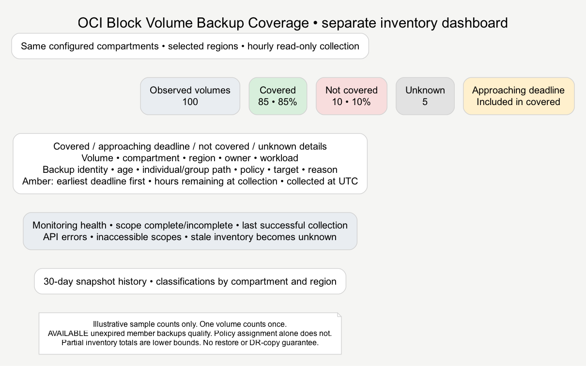
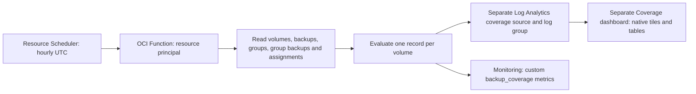

# Optional Block Volume Backup Coverage dashboard

Coverage is a separate OCI Console Management Dashboard, enabled with `enable_coverage = true`. Activity event queries, dashboard identities and the Events/stream/connector pipeline are unchanged. Coverage reuses the exact `inventory_compartment_ids`; it adds no compartments automatically. It never creates, copies, changes or deletes backups or policies.



## Architecture



Sixteen widgets provide seven numeric tiles (total, covered count/percent, uncovered count/percent, unknown and warning), four volume-detail tables (covered, approaching deadline, not covered and unknown), monitoring health, collection errors, last fully successful collection, thirty-day snapshot history, and classifications by compartment/region. Green means covered, amber means approaching a deadline, red means uncovered, grey means unknown/stale. Native tile captions are Volumes or Percent. Empty/no-results is unknown, never a healthy zero. The preview numbers are illustrative, not live data.

The amber detail table sits below Covered and lists only warning volumes from the latest fresh snapshot, ordered by the earliest deadline. It includes volume identity, compartment/region, owner/workload where tagged, individual/group-member path, backup identity/time/age, recovery target/grace, assigned policy and reason. `HoursRemainingAtCollection` is `(Deadline - RunEpoch) / 3600`, rounded to two decimals; `CollectedAtUTC` shows when that snapshot was collected. This is a snapshot value, not a live countdown. Deadline uses the collector's earlier-of-expiration-and-recovery-target calculation. Amber volumes remain in Covered and its percentage. Stale data appears in Unknown instead. Internal run-selection/helper columns are excluded from the amber table. No new inventory fields, schema, IAM or Terraform resources are required.

The Function directly uploads structured records with the supported Log Analytics LogEvents API. Requests explicitly use `Content-Type: application/octet-stream` for the file bytes and `payloadType=JSON` for the file format. It does not need a new Service Connector or stream. The Python deployment script reuses the guarded JSON schema installer with a distinct source, parser and field prefix. No Terraform provisioners or embedded executable commands are used. Monitoring metrics are derived custom telemetry, not native OCI Block Volume backup metrics.

Terraform also creates an OCI Logging group `backup-coverage-runtime-<scope>` and an enabled Functions `invoke` service log for the Coverage application, retained for 30 days. This captures platform invocation logs and the Function's stdout/stderr. It is separate from the Log Analytics inventory log group. It needs no additional Function permission to push custom logs, and no Service Connector. These resources follow `enable_coverage` and use the telemetry compartment; the Activity pipeline is unchanged.

## Coverage calculation

Only block volumes are counted; boot volumes are excluded. All non-terminated/non-terminating observed volumes are included, once per region/OCID, irrespective of how many backups exist. For each volume, an AVAILABLE, unexpired volume backup is evidence. Group-member backups have their own volume OCIDs and AVAILABLE states; they qualify identically. Group membership alone and an AVAILABLE parent without a usable member backup do not establish protection. Parent group-backup listings provide optional lineage when the member's group-backup ID is absent.

The backup snapshot's `time_created` is used for age, not an event, request acceptance or inventory collection time. Available backups with missing, future or invalid dates cannot prove coverage. The deadline is the earlier of backup expiration and snapshot time + target hours + grace hours. At the deadline the volume is uncovered. Within warning hours before it, the volume is amber but remains included in the covered total. Grace extends the configured target explicitly; set it to zero for strict targets. Classification is as of collection time, not a continuous restore guarantee.

Precedence is default target → workload tag override → volume OCID override. Owner/workload come from configurable free-form tags; absent owners are blank. Policy assignments on the volume and its current group are shown as policy OCIDs. `PolicyState=none` is distinct from no usable backup. A manually backed-up volume can be covered with no policy. Policy definitions are not interpreted as recovery targets; targets are explicit operator configuration.

Every list API paginates and guards repeated page tokens. A failed page discards that API call's partial result. Any core inventory failure makes known volumes in that region unknown, conservatively including otherwise positive evidence, because the regional inventory is incomplete. A policy-assignment error makes that volume unknown. Failed scopes generate explicit error rows. Entirely inaccessible compartments have an unknown number of volumes: observed totals are lower bounds, scope is marked incomplete, and headline percentages are suppressed. Other readable regions may still show observed covered counts. Percentages on a complete scope use **all observed volumes**, including unknowns, as denominator. Zero volumes yields no percentage, not 100%.

Only backups in configured compartments/regions are examined. Moved backups outside that scope are not inferred; include their compartments if needed. Cross-region requirements and source→destination lineage reconciliation are not implemented in this first version. Scanning several regions evaluates each region's observed volumes and local matching backups; it is not a DR coverage assessment.

## Complete snapshots and freshness

Each run has a UUID, start epoch, per-record identity and expected record count. Volume/error rows upload in bounded batches; a summary uploads last. Queries deduplicate `(RunID, RecordID)`, require the expected number of distinct records, and select the newest fully indexed run by its start epoch. Partial uploads, delayed indexing, retries and overlapping runs cannot mix volume records from different snapshots. A newer snapshot naturally removes volumes absent from that snapshot. No checkpoint bucket or lock service is required; concurrent scans can cost more API calls, but older runs cannot supersede newer completed ones.

A complete-ingestion run can still contain inventory errors: ingestion completeness and scope completeness are different. Older incomplete uploads are never selected. If no recent complete-ingestion run exists, the previous snapshot ages into unknown. At `stale_hours` (default two), covered/uncovered/warning tiles are blank, known volumes move to unknown, and detail rows say stale. Observed total remains the last known count. Monitoring health displays the run epoch, scope state, freshness and errors; the last fully successful collection is queried separately across retained runs.

Choose a global dashboard time range that includes the latest run. OCI's global time picker can override saved windows. Selecting an older historical range displays stale classifications rather than claiming current health. The snapshot-history table defaults to thirty days and excludes incomplete scopes. No data before collection began is fabricated or backfilled.

Numeric tiles finish with an explicit single numeric aggregate (`stats max(...) as Value`), rather than counting the one summary record. Genuine zero values remain zero. Stale covered/uncovered/warning measures and incomplete-scope percentages have no eligible row and remain unknown/blank; missing snapshots are never replaced with zero. The unknown tile uses the last observed total when stale. Filtering eligibility before aggregation also avoids the service returning null when MAX consumes an IF-derived field after STATS. Dashboard and saved-search identities are preserved when upgrading this correction.

## Prerequisites and IAM

- Existing activity deployment settings/state, Log Analytics onboarded in the profile region, Python environment and Terraform. Coverage Function `source_details` requires a recent OCI provider (validated locally against 9.12.0).
- Docker CLI with the Buildx plugin for local linux/amd64 packaging, provided by Docker Desktop or Colima, and prior Docker login to OCIR. The deployer creates/reuses the repository and publishes the image automatically unless an existing image override is supplied. The deploy profile needs repository/image access and permissions to create Functions/application, use the supplied subnets, manage resource schedules, import dashboards and install Log Analytics metadata. These deployer/reader permissions are not self-granted.
- Existing one-to-three regional Function subnets with DNS and API egress. For same-region OCI endpoints, configure a service gateway/appropriate routes and security rules; multi-region scans may require NAT/routing to remote public OCI APIs. Networking is not provisioned by this feature. Image pull and any application image-signature policies must already be permitted.
- With `create_iam_policy=true`, Terraform creates two exact-resource dynamic groups in the tenancy home region: one for this Function and one for this schedule. One additional policy grants the Function read access to volumes, volume backups, groups, group backups and assignments in each configured compartment; uploads only to its coverage log group; and writes only the custom metric namespace. The schedule gets function-read/invocation permission scoped to this Function. No backup write permission is granted.
- With `create_iam_policy=false`, create equivalent groups/policy externally using the Function and schedule output IDs. Required statements are output as `coverage_iam_statements`; use the same group names or adapt the statements. IAM propagation may delay the first scheduled run. A running function's credentials are resource-principal credentials; no user key or OCIR token enters its configuration or source.

## Prepare and deploy when ready

Keep your existing compartment list and `build/native-events` state directory. The additional minimal tfvars are:

```hcl
enable_coverage     = true
coverage_subnet_ids = ["ocid1.subnet.oc1.ap-sydney-1.YOUR_SUBNET"]
# If equivalent runtime/scheduler policies do not already exist:
create_iam_policy   = true
```

You no longer need to supply an image URI. Region comes from the selected OCI profile; namespace comes from the tenancy. For commercial regions the registry hostname is derived from the OCI SDK's region-key mapping (Sydney → syd.ocir.io). For unsupported mappings/non-commercial realms, explicitly set the documented regional `coverage_registry_host`. Repository name defaults to `backup-coverage`, compartment defaults to the resolved `dashboard_compartment_id` (or telemetry when dashboard compartment is omitted), and image tag defaults to a hash of the packaged Python files, Dockerfile, requirements and build-context rules. The build uses linux/amd64 and labels the image with that hash. The hash is a source version, not a claim that upstream base-image tags or dependency ranges are immutable; pin those inputs if required for reproducibility.

Log in to your regional OCIR with Docker's supported credential workflow first. OCI API profile authentication and Docker registry authentication are separate. Never place auth tokens in tfvars, source or command arguments.

```bash
# Interactive login: enter your namespace/domain/user and OCI auth token when prompted.
docker login syd.ocir.io
python scripts/deploy.py --profile YOUR_PROFILE --prepare
python scripts/deploy.py --profile YOUR_PROFILE --plan
# This changes OCI resources and publishes a container image; run when ready:
python scripts/deploy.py --profile YOUR_PROFILE --apply
```

For Colima, start it yourself and use its context, or explicitly allow startup:

```bash
python scripts/deploy.py --profile YOUR_PROFILE --apply --docker-context colima --start-colima
```

The deployer checks the Linux Docker engine, Buildx availability and local registry credential configuration before repository apply when a build is needed. It does not log in, generate tokens or change global Docker context. A configured credential helper is not proof of valid registry credentials or push permissions; Docker push performs that check. Colima starts only with the explicit flag and only when the selected engine is unavailable. Cross-architecture emulation must support linux/amd64; build failures stop the deployment. There is no Docker access on `--prepare` or `--plan`.

### Two states and two plans

| Stage | Local state | What happens |
| --- | --- | --- |
| OCIR bootstrap | build/native-events/ocir/terraform/terraform.tfstate | Plan/apply one private repository, or look up a private existing repository |
| Preliminary dashboard preview | Uses existing dashboard state; JSON report only, no retained executable plan | Preview Activity/Coverage changes with pending image tag and enforce deletion guard |
| Image publication | build/native-events/image-checkpoints/*.json and coverage-image.json receipt; not Terraform state | Resume verified build/push phases, compare manifest digest with OCIR and record publication |
| Dashboard infrastructure | build/native-events/terraform/terraform.tfstate | Final plan; schema installation; apply Function, IAM, schedule, coverage dashboard and existing activity resources |

One `deploy.py --apply` orchestrates those stages in order, without targeted applies or Terraform provisioners. The final Function definition passes the tagged repository name in `source_details.image` and the separately verified SHA in `source_details.image_digest`, as required by the Functions API. Logical verified references/receipts may use `repository:tag@sha256:…`; deploy.py splits those before Terraform apply. A digest-only user override is resolved to an existing registry tag first. Failure stops the remaining stages. A partial run may leave a repository or pushed image, but no automatic cleanup/deletion occurs: preserve both states and the image receipt and rerun after resolving the problem.

`--prepare` is offline and generates bootstrap intent, schema and dashboard artifacts. When no verified image exists, `--plan` saves the OCIR bootstrap plan and runs a clearly labelled **preliminary dashboard plan against the existing dashboard state** using the pending image tag. Only the JSON preview report (`terraform-preliminary-plan.json`) is retained; its temporary binary plan is deleted and the generated configuration is restored. Older final dashboard plan artifacts are invalidated so they cannot be mistaken for the current preview. Image publication and the final digest-based plan remain pending. When a matching source/digest receipt and AVAILABLE OCIR image exist, it also saves the final dashboard plan. `--apply` also runs the preliminary dashboard preview and deletion guard before repository creation or image publication when a new image is needed. It then replans with the verified pushed digest before schema installation and dashboard apply. A rejection or API failure in that later final plan can still leave earlier repository/image artifacts; those are retained. The preview shows existing Activity/dashboard changes plus proposed Coverage infrastructure, but is not the final Function image plan. Review the final plan as well.

A matching private repository in the configured compartment can be reused as a data source without adoption or mutation. `coverage_existing_repository_id` selects one explicitly. Once this deployment manages a repository, reruns keep that managed resource address. Repository replacement/deletion is blocked, and the OCIR identity guard refuses changes to tenancy, region, repository name or compartment in an existing state directory. Such changes need a reviewed migration, not state deletion.

If Docker push exits with an error, the deployer may confirm publication through read-only local-image/remote-manifest inspection. It continues only when the source label, linux/amd64 platform and exact manifest/config identity match; the OCI Artifacts digest check still follows. A partially uploaded child manifest with an unmatched local index does not qualify. Recognized push failures are reported by category without echoing signed URLs, tokens or raw HTTP bodies. No push retry is performed by this confirmation.

Image reuse uses both the final receipt and durable per-image progress journals. OCI repositories may be mutable: the CreateContainerRepository API currently does not support setting isImmutable, so this module omits it. Known remote digest drift is refused; deployer checks are client-side protection, not a server-enforced tag lock. Deployments use the pinned digest, not the mutable tag.

### Durable build and publication checkpoints

Progress is stored privately under `build/native-events/image-checkpoints/*.json`, independently of both Terraform states. The deployer prints the current checkpoint path/phase. Journal identity includes tenancy, region, repository compartment, tag URI, full packaged source hash and linux/amd64 platform. Each update is atomic, mode 0600, and syncs the file and directory entries before returning. The deployment's existing output-directory lock serializes the workflow. No credentials, signed URLs or raw Docker errors are recorded.

| Saved phase | Rerun behavior |
| --- | --- |
| intent / building | Inspect the local tag; reuse a completed build with the exact source label and target platform, otherwise build |
| built | Reuse only the matching saved local image ID/source/platform; rebuild if that pre-publication cache has been evicted |
| pushing, no recorded digest | If OCIR has the tag, verify its manifest against the saved build identity and skip repush on an exact match. Otherwise resume push of the same verified local image. A missing/changed local image with no confirmed remote publication stops for review |
| pushed | Verify the saved push digest through OCI Artifacts; no rebuild/repush, even when Docker's cache or final receipt is gone |
| published | Recheck the OCI digest, reuse publication and recreate the final receipt if needed; Terraform continues through its normal state-based planning |

A completed build is recorded before starting push, and a successful push digest is recorded before potentially delayed OCI visibility checks. If the process stops between a remote commit and the local digest update, the saved build identity provides recovery evidence. A partially uploaded child with an unmatched local index does not qualify. If OCI cannot yet confirm a recorded digest, stop with the checkpoint retained and retry verification on the next run; do not silently republish or mark success.

`--prepare` does not touch image journals. `--plan` reads progress and OCI metadata only: a pushed/published digest matching OCIR can support the final plan immediately; publication requiring Docker confirmation remains pending and gets a preliminary dashboard preview. Neither mode runs Docker or advances a checkpoint.

Different source code, image tag or scope gets a different checkpoint. Changing packaged code intentionally starts a new image version; this includes the first upgrade introducing checkpoint support. Uncheckpointed historical remote images are not silently adopted: explicitly select a verified existing image or use a fresh tag. Checkpoints and the legacy `coverage-image.json` receipt are retained alongside state; do not delete them to recover from ordinary deployment failures. No build/push or Function invocation is triggered merely by adding this feature.


Optional overrides:

```hcl
# coverage_repository_name           = "backup-coverage"
# coverage_repository_compartment_id = "ocid1.compartment.oc1..YOUR_REPOSITORY_COMPARTMENT"
# coverage_existing_repository_id    = "ocid1.containerrepo.oc1.ap-sydney-1.YOUR_REPOSITORY"
# coverage_image_tag                 = "custom-version"
# coverage_registry_host             = "syd.ocir.io"
# Bypass automatic repository/build/push; SDK verifies and pins this existing image:
# coverage_function_image = "syd.ocir.io/YOUR_NAMESPACE/backup-coverage@sha256:YOUR_DIGEST"
```

An existing-image override skips the bootstrap and Docker entirely. Set the repository compartment override if that image's repository is outside the dashboard compartment. Keep using the same regional registry alias or specify `coverage_registry_host` to match it. Previously managed OCIR state remains retained when switching to an existing-image override.

Builds explicitly use `docker buildx build --output type=docker,oci-mediatypes=false --provenance=false --platform linux/amd64`, auto-loading a local single-platform Docker-format image for the subsequent digest-verified push. Provenance attestation indexes are intentionally omitted for this Function image. The deprecated legacy builder is never selected. If Buildx is missing, install it (on Homebrew: `brew install docker-buildx`) and register its plugin directory as described by [Homebrew](https://formulae.brew.sh/formula/docker-buildx), then verify `docker buildx version`. The preflight stops before repository apply when a build is needed and Buildx is unavailable. A content-digest-not-found error is a local builder/image-store problem, not a backup API failure; switching builders does not establish that existing cache corruption is repaired. The deployer never prunes images or resets Colima automatically.

The standalone [image helper](../scripts/build_coverage_image.py) remains available for manual workflows (`--image`, optional `--push`, `--docker-context`, `--start-colima`). Target settings are shown below and in [backup-coverage.example.json](../config/backup-coverage.example.json); the deployer reads tfvars, not that JSON example.

After image publication and final planning, Python installs/tests activity and coverage schemas, then applies the reviewed dashboard plan. The schedule invokes the Function detached, hourly at minute 10 UTC by default, with a 30-minute execution timeout and 512 MB. Authorized operators can invoke it manually in Detached mode. Invocation bodies cannot broaden configured scope. The first invocation may need to wait for IAM propagation and indexing. No synthetic records are uploaded by deployment, and no live tfvars are modified by implementation.

Resource Scheduler's per-schedule minimum interval is one hour. Turning coverage off after applying would delete resources, so the existing deletion guard requires a reviewed removal workflow. Function configuration has service size limits; the deployer rejects oversized settings. Large scopes need external configuration/sharding before use, and may exceed scan timeout or Log Analytics query limits. This implementation targets bounded compartment sets and never silently truncates scans.

## Configuration defaults and overrides

Normal tfvars need only `enable_coverage` and `coverage_subnet_ids` in addition to the existing activity settings. Subnet selection cannot be inferred safely from a region/compartment; supply the existing Function subnets explicitly. Image and repository details are deliberately omitted from the minimal tfvars example. All advanced variables remain supported as explicit overrides.

| Coverage input | Default or derivation | When to set it |
| --- | --- | --- |
| enable_coverage | false | Set true to add Coverage |
| coverage_subnet_ids | No automatic selection | Required when enabled |
| coverage_function_image | Built/pushed URI, pinned to verified digest | Use an existing image instead of automatic publication |
| coverage_repository_name | backup-coverage | Choose another repository name |
| coverage_repository_compartment_id | Resolved dashboard_compartment_id; dashboard itself falls back to telemetry | Reuse/provision a repository in another compartment |
| coverage_existing_repository_id | Exact private repository discovered by name/compartment, otherwise created | Select a particular existing repository explicitly |
| coverage_registry_host | Selected profile region's OCIR hostname | Unsupported mapping/realm or alternate documented hostname |
| coverage_image_tag | Packaged source hash | Deliberate custom image version |
| coverage_regions | Selected profile region | Inventory more regions |
| coverage_schedule | 10 * * * * (hourly UTC) | Change the collection time/frequency |
| coverage_settings | 24h target, 0h grace, 4h warning; stale after 2h; workload/owner free-form tags | Set workload/volume recovery requirements |
| coverage_dashboard_file / coverage_source_name / coverage_function_image_digest | Generated by deploy.py | Never set in user tfvars |

Recovery targets cannot be inferred reliably from backup policy assignments; the default is an operator-visible assumption, not an automatically discovered RPO. Optional target overrides:

```hcl
coverage_settings = {
  default_target = { target_hours = 24, grace_hours = 0, warning_hours = 4 }
  workload_targets = {
    critical = { target_hours = 6, grace_hours = 1, warning_hours = 2 }
  }
  volume_targets = {
    "ocid1.volume.oc1.ap-sydney-1.YOUR_VOLUME" = { target_hours = 12, grace_hours = 0, warning_hours = 2 }
  }
  workload_tag = "workload"
  owner_tag    = "owner"
  stale_hours  = 2
}
```

For previously prepared/applied bootstrap state in a different compartment, set `coverage_repository_compartment_id` to that current compartment to retain it. The identity guard will not silently move or recreate a repository when the default changes.

## Runtime diagnostics and verifying a run

The deployment profile additionally needs `manage log-groups` in the telemetry compartment and permission to update the Function application to enable its service log. Operators need `read log-groups` and `read log-content` there to inspect it. These deployer/reader privileges are not granted to the inventory Function. See [Logging IAM](https://docs.oracle.com/en-us/iaas/Content/Identity/Reference/loggingpolicyreference.htm) and [resource permissions for service logs](https://docs.oracle.com/en-us/iaas/Content/Logging/Task/managinglogs.htm).

Open the Coverage application → Monitoring → Logs → Function Invocation Logs, or OCI Logging → Log Groups → `backup-coverage-runtime-<scope>`. Terraform exports `coverage_runtime_log_group_id` and `coverage_runtime_log_id`, also exposed by deploy.py's generated wrapper. The scheduler depends on the enabled log. Logs start after deployment; past invocations are not reconstructed.

Structured stdout events share a `run_id`: `coverage.started`, `coverage.inventory.started`, `coverage.inventory.completed`, `coverage.upload.started`, one `coverage.upload.accepted` per batch (summary last), `coverage.metrics.started`, and `coverage.completed`. Inventory completion includes observed volume count, scope state and collection error count. An incomplete scope remains incomplete even when publication succeeds. Upload acceptance includes the OCI request ID; it does not prove indexing has finished. Failures emit `coverage.failed` with stage (`authentication`, `inventory`, `log_upload` or `metrics`), exception type, HTTP status, service code and OCI request ID, then re-raise so the invocation fails. Configuration, backup payloads, credentials and raw SDK exception messages are not included in these diagnostic events. Container/FDK startup failures appear in the service log without a collector start event.

Verify the scheduler work request, the invocation logs, then a fresh complete-ingestion snapshot and custom metrics. Schedule `SUCCEEDED` or an acceptance/success metric alone does not establish successful collection/publication. Expected recovery after upgrading: a new source-versioned image, two new Logging resources, an in-place Function image update, and the existing hourly schedule. No new tfvars are required. Existing state and image checkpoints are retained. Rerun the normal deployment command (add `--docker-context colima` when needed), then wait for the next scheduled run; deployment does not invoke the Function.

The first deployment's Audit record showed successful inventory reads followed by `UploadLogEventsFile` HTTP 415 with `Content-Type: application/json`. The runtime now explicitly specifies the binary upload media type instead of inheriting the SDK/signing default. Offline regression tests inspect the real SDK request headers/body and inject failures at each runtime stage. End-to-end acceptance/indexing of the corrected upload remains an operator deployment check.

## Derived metric definitions

All metrics are gauges in custom namespace `backup_coverage`, stored in the telemetry compartment/profile region, with dimensions `scope` and `collectorRegion`. Timestamps use collection start; the LA snapshot is the dashboard's authoritative data source. Metrics are supplementary for operator-defined alarms. No alarms/subscriptions are automatically created.

| Name | Meaning |
| --- | --- |
| Total | Observed block volumes; lower bound when scope incomplete |
| Covered | Green + amber volumes in the observed scope |
| Uncovered | Observed volumes with confirmed missing/old usable backup evidence |
| Unknown | Observed volumes whose coverage could not be evaluated |
| Warning | Amber volumes, already included in Covered |
| CoveredPct / UncoveredPct | Counts / Total × 100; omitted on incomplete scope or zero total |
| ErrorCount | Inventory/assignment/client initialization errors in the run |
| ScopeComplete | 1 when all configured inventories and assignments succeeded; otherwise 0 |

Expired/stale metric samples must not be treated as current health. Use absence alarms and inspect collection freshness. Logging upload failures prevent the summary commit; failed metrics raise an invocation error. Metrics are published after log upload acceptance, but indexing is asynchronous and may lag. Function timeout/authentication/publishing failures can prevent fresh error records: the stale-data checks are essential. Collection success means inventory was read, not that all volumes are covered or restore-tested.

## Official capability references

Reviewed 11–12 November 2026:

- [OCIR repository Terraform resource](https://registry.terraform.io/providers/oracle/oci/latest/docs/resources/artifacts_container_repository), [OCIR Docker authentication](https://docs.oracle.com/en-us/iaas/Content/Functions/Tasks/functionslogintoocir.htm), and [Artifacts image lookup API](https://docs.oracle.com/en-us/iaas/tools/python/latest/api/artifacts/client/oci.artifacts.ArtifactsClient.html).
- [Scheduling Functions](https://docs.oracle.com/en-us/iaas/Content/Functions/Tasks/functionsschedulingfunctions-about.htm): Resource Scheduler, dynamic groups and detached invocation.
- [Creating a schedule](https://docs.oracle.com/en-us/iaas/Content/resource-scheduler/tasks/create-manage.htm): UTC and minimum interval.
- [Function resource principals](https://docs.oracle.com/en-us/iaas/Content/Functions/Tasks/functionsaccessingociresources.htm) and [restricted invocation](https://docs.oracle.com/en-us/iaas/Content/Functions/Tasks/functionsrestrictinguseraccess.htm).
- [Core service IAM](https://docs.oracle.com/en-us/iaas/Content/Identity/Reference/corepolicyreference.htm) and [Monitoring IAM](https://docs.oracle.com/en-us/iaas/Content/Identity/policyreference/monitoringpolicyreference.htm).
- [BlockstorageClient APIs](https://docs.oracle.com/en-us/iaas/tools/python/latest/api/core/client/oci.core.BlockstorageClient.html), [VolumeBackup model](https://docs.oracle.com/en-us/iaas/tools/python/latest/api/core/models/oci.core.models.VolumeBackup.html) and [backup concepts](https://docs.oracle.com/en-us/iaas/Content/Block/Concepts/blockvolumebackups.htm).
- [LogEvents uploads](https://docs.oracle.com/en-us/iaas/log-analytics/doc/upload-event-logs-using-logevents-api.html): file sources, encoded log records and upload size limits. Batches stay below 1.5 MB.
- [Function invocation logs](https://docs.oracle.com/en-us/iaas/Content/Logging/Reference/details_for_functions.htm) and [enabling Function logging](https://docs.oracle.com/en-us/iaas/Content/Functions/Tasks/functionsexportingfunctionlogfiles.htm): application-level `invoke` service logs include stdout/stderr. [Terraform Logging resource](https://registry.terraform.io/providers/oracle/oci/latest/docs/resources/logging_log).
- [eventstats](https://docs.oracle.com/en-us/iaas/log-analytics/doc/eventstats.html), [eval/date conversion](https://docs.oracle.com/en-us/iaas/log-analytics/doc/eval.html), and the repository's verified native tile/table export shapes.

Implementation checks include offline unit tests and read-only Log Analytics service validation of generated queries. The freshness expression uses numeric epoch arithmetic, with intermediate fields rather than arithmetic nested in date-function arguments. No dashboard/search changes, log uploads, Function deployment or image push were performed during the query fix. Image startup, network routing and end-to-end collection remain operator deployment verification steps; query parsing alone does not prove collection is healthy.
